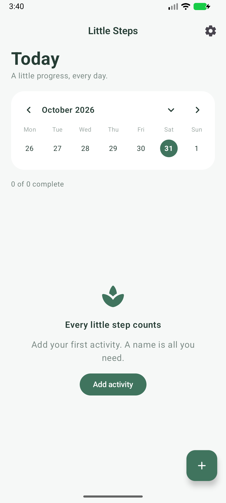

# Little Steps MVP

Offline Android habit tracker written in Kotlin and Jetpack Compose. Android 10+ (API 29), compile/target SDK 37, original application ID `com.example.littlesteps`.

## Use

- Starts in English, regardless of the phone language. Settings → Language switches to Russian immediately; DataStore remembers the choice.
- Add an activity with only a name. Icon and color are automatic. Tap the name to customize them.
- Tap a completion circle to complete/undo. For measured activities, this sets the daily goal; hold the circle to enter a total quantity. A quantity below the goal is partial progress. Clear entry removes that day's quantity.
- Open activity settings → Advanced settings for daily quantity goals, custom units, weekdays, and an optional daily reminder.
- Reorder enters manual drag mode. Drag any card up/down; order saves on release. Done leaves the mode. The order is shared across dates.
- Calendar arrows browse weeks; the expand button switches to a month. Tap a date to view/edit its history. Up to three colored dots show completed activities. Future dates are read-only.
- Archive removes an activity from today onward; earlier records remain. There is no permanent-delete or unarchive screen in this MVP.

## Data and reminders

Room stores activities and date-keyed totals locally (`little-steps.db`). DataStore stores language. No login, backend, network permission, or analytics. Android backup remains enabled as in the original project. Activity names and custom units are user content and are not translated.

Reminders use WorkManager and survive process restarts/reboots. They are approximate daily notifications, may be delayed by Android battery policies, and skip completed/off-schedule/archived activities. Android 13+ requests notification permission when you enable a reminder. After changing time zones or daylight-saving transitions, resave the reminder to align its 24-hour schedule with the new local time. Notification delivery after a force-stop requires reopening the app.

Schedule, unit and goal settings belong to each activity; changing them also changes how its earlier entries are displayed/evaluated. Historical values remain stored. This MVP does not snapshot every historical version of an activity's settings.

## Build

Install Android Studio and Android SDK 37, open this folder, and sync Gradle. The checked-in Gradle daemon configuration uses JDK 25. On macOS, you can use Android Studio's bundled JDK:

```bash
export JAVA_HOME='/Applications/Android Studio.app/Contents/jbr/Contents/Home'
./gradlew :app:assembleDebug :app:testDebugUnitTest :app:lintDebug
./gradlew :app:connectedDebugAndroidTest
```

The last command needs a running emulator or USB-debugging phone. APK: `app/build/outputs/apk/debug/app-debug.apk`. Install with Android Studio, or `adb install -r app/build/outputs/apk/debug/app-debug.apk`.

Original AGP 9.5.0, Gradle 9.6.0, namespace, target SDK and release configuration are preserved. Compose is enabled using Kotlin's Compose compiler plugin; Room uses AGP's legacy-kapt bridge with built-in Kotlin. Language splits are disabled so both languages ship offline.

This is a debug-signed test build. Store publishing and release signing are not configured.


## Try the MVP

Download the [debug APK](downloads/LittleSteps-MVP-debug.apk) and install it on an Android 10+ phone. This is a debug-signed build for testing, not a store release. Android may ask you to allow installation from your browser or file manager.

The APK was built on October 31, 2026. Its SHA-256 is `f93b474bddd8addb429e07df2498ec2379bacd243db53b9c61d5ae219fe9e9aa`.

See [verification notes](docs/verification.md) for the tested scenarios and remaining limitations.


