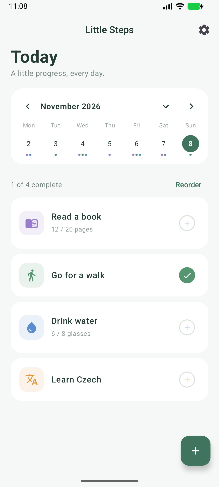
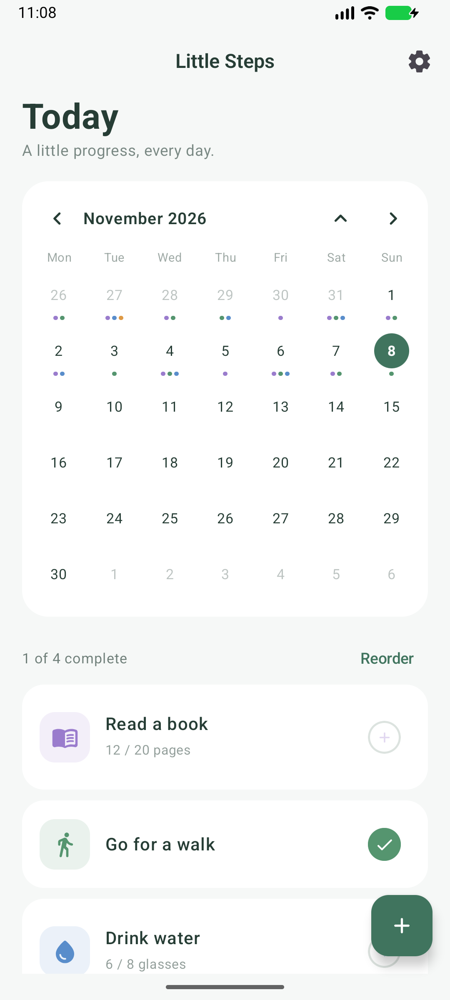
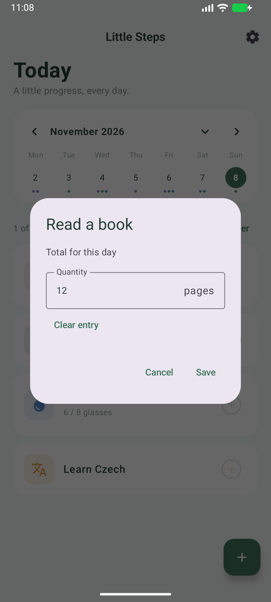
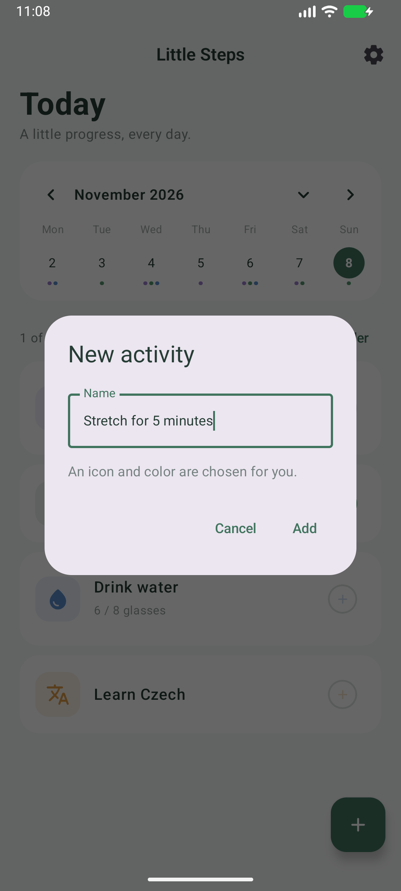
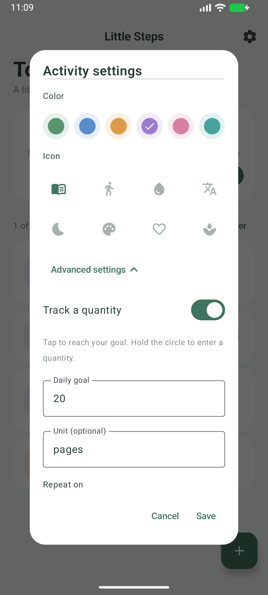
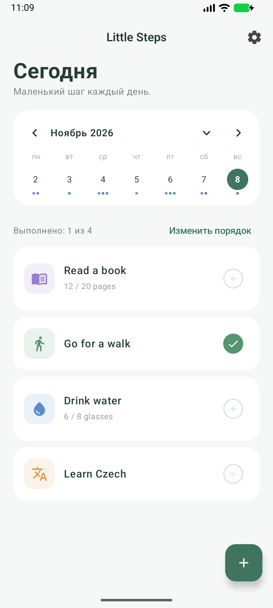

# Little Steps

Приложение для небольших ежедневных дел: прочитать несколько страниц, выйти на прогулку, пить воду или заниматься языком.

Добавьте активность, отмечайте сделанное и смотрите историю в календаре. Для начала достаточно названия. Цель, расписание и напоминание можно настроить позже.

**Работает без интернета · Без регистрации · Английский и русский · Android 10+**

[Скачать тестовый APK](https://github.com/sturivny/little-steps/raw/refs/heads/main/downloads/LittleSteps-MVP-debug.apk) · [English](README.md) · [Больше скриншотов и примеров](docs/walkthrough.md)

## Как это выглядит

Это реальные экраны приложения с демонстрационными активностями и историей.

| Что сделать сегодня | Прогресс за месяц | Учёт количества |
|:---:|:---:|:---:|
|  |  |  |
| Нажмите на кружок, чтобы отметить выполнение. Ещё раз — чтобы отменить. | Выберите дату, чтобы посмотреть этот день. Цветные точки показывают выполненные активности. | Удерживайте кружок измеряемой активности, чтобы указать страницы, стаканы, минуты или другое количество. |

## Как начать

1. Нажмите **+**, введите, например, «Прогулка» и нажмите **Добавить**. Иконка и цвет подберутся автоматически.
2. Сделайте своё дело и нажмите на кружок. Больше ничего настраивать не нужно.
3. Если захотите учитывать количество или получать напоминания, нажмите на название активности и откройте **Дополнительные настройки**.

| Достаточно названия | Цель — по желанию | Русский интерфейс |
|:---:|:---:|:---:|
|  |  |  |
| Без обязательной цели, расписания или напоминаний. | Например, читать 20 страниц в день и записывать фактическое количество. | **Settings → Language → Русский**. Названия ваших активностей не переводятся. |

При первом запуске интерфейс английский. После переключения язык сохраняется.

**12 / 20 страниц** — это записанный прогресс, даже если цель ещё не достигнута. Короткое нажатие на кружок выставляет количество до цели, повторное — удаляет отметку за этот день.

Чтобы поменять порядок, нажмите **Изменить порядок** и перетащите карточки. Порядок сохранится при отпускании. Календарь можно раскрыть до месяца; стрелки позволяют перейти к прошлым датам. Будущие дни доступны только для просмотра.

[Ещё примеры: история, порядок карточек и напоминания →](docs/walkthrough.md)

## Попробовать на телефоне

1. Скачайте [LittleSteps-MVP-debug.apk](https://github.com/sturivny/little-steps/raw/refs/heads/main/downloads/LittleSteps-MVP-debug.apk) на телефон с Android 10 или новее.
2. Откройте файл. Если Android попросит, разрешите установку приложения из браузера или файлового менеджера.
3. Откройте **Little Steps** и добавьте первую активность.

Это ранняя тестовая версия с отладочной подписью, а не публикация в магазине. APK собран 31 октября 2026 года; примеры на скриншотах сняты 8 ноября 2026 года.

## Что важно знать

- Активности и записи хранятся на устройстве. Регистрация, сервер и облачная синхронизация не нужны. Системное резервное копирование Android включено.
- Время напоминаний приблизительное: Android может задерживать их ради экономии батареи. На Android 13+ нужно разрешить уведомления. Вибрацию и своевременность напоминаний ещё нужно проверить на реальном телефоне.
- Изменение цели, единиц или расписания влияет и на отображение и оценку прошлых записей. Записанные количества сохраняются.
- Архивирование убирает активность с сегодняшнего дня, сохраняя прошлые записи. Экрана восстановления из архива пока нет.

Для разработки: [сборка и тесты](docs/development.md), [результаты проверки](docs/verification.md).
