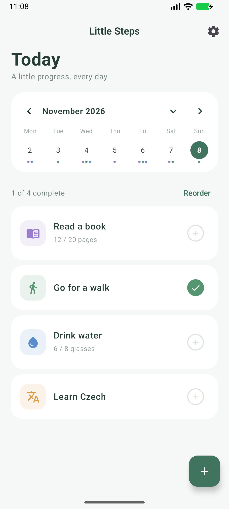
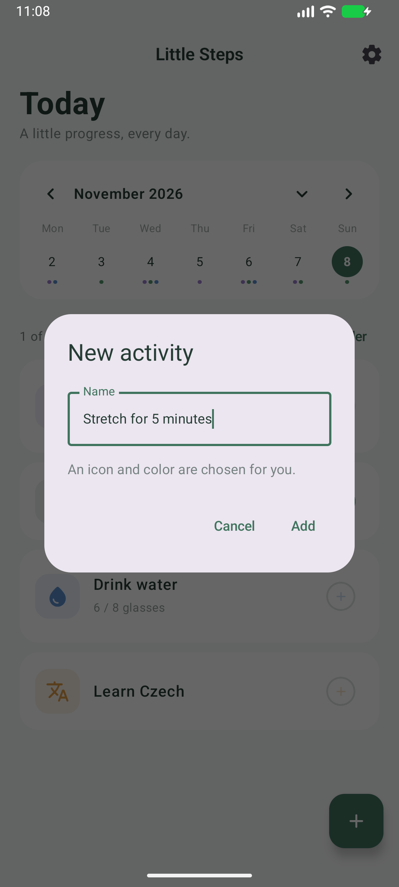
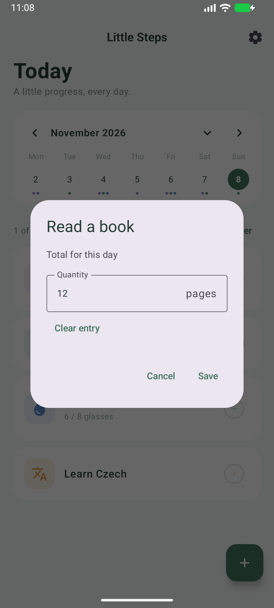
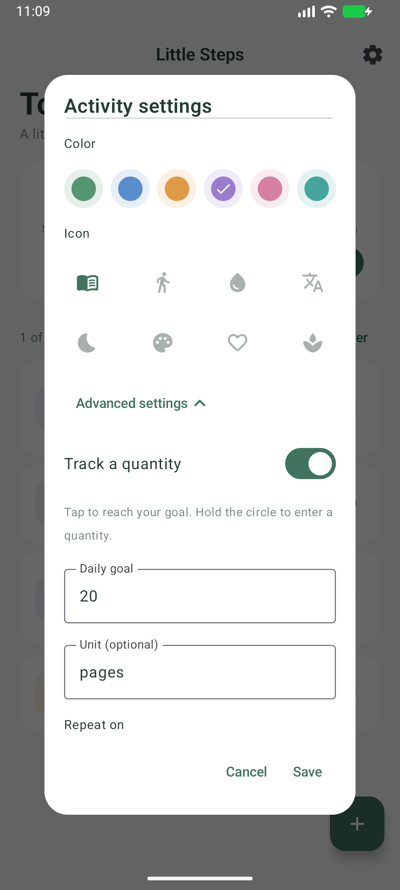
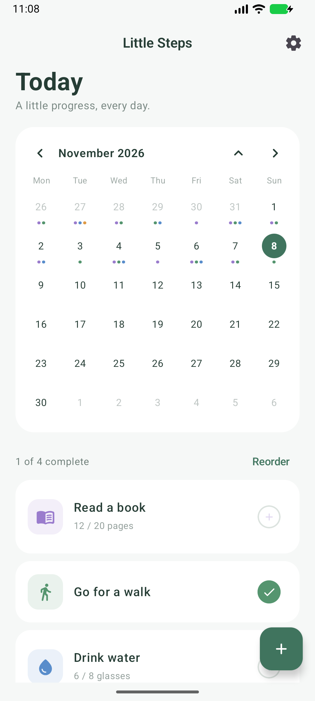
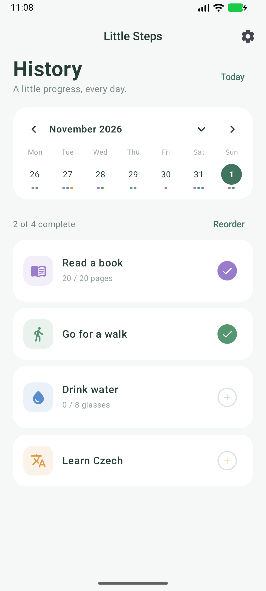
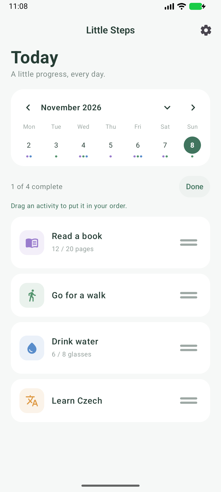
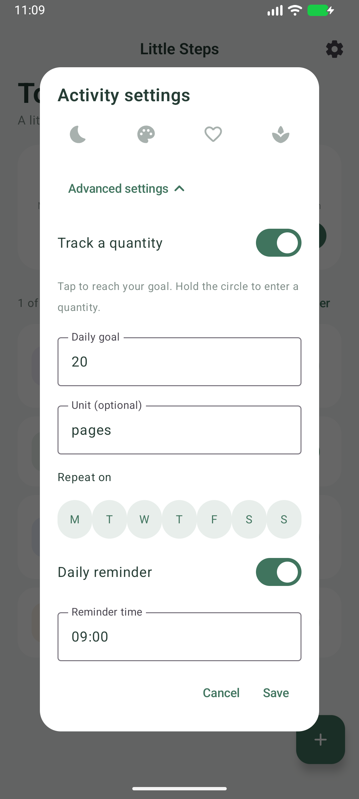
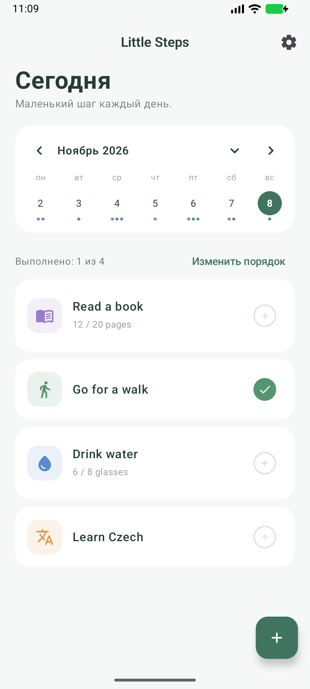

# A day with Little Steps

Little Steps helps you keep track of small, repeatable activities. This guide uses reading, walking, drinking water, and learning Czech as examples. You can give your activities any names you like.

All pictures below are real app screenshots with demonstration data. The example history is there to show how the calendar works.

[Back to the introduction](../README.md) · [По-русски](../README.ru.md)

## 1. Choose a few things for today

The Today screen puts your activities in one list. A checked circle means complete. A quantity such as **12 / 20 pages** means you've recorded some progress and haven't reached the goal yet.

| Today's list | Add an activity |
|:---:|:---:|
|  |  |

Tap **+**, enter a name, and tap **Add**. An icon and color are chosen automatically. You can change them later by tapping the activity's name.

## 2. Record what you actually did

For a simple activity, tap its circle to mark it done. Tap again to undo.

For a measured activity, hold its circle to enter a total for the selected day. For example, enter **12** after reading twelve pages. The value replaces the day's previous total; it is not added on top. **Clear entry** removes it. A short tap on the circle sets the total to the daily goal, and another tap clears it.

| Enter a daily total | Add a goal and units |
|:---:|:---:|
|  |  |

To set this up, tap the activity's name → **Advanced settings** → **Track a quantity**. Set a daily goal and, if you want, a unit such as pages, glasses, minutes, or kilometres. You can also choose which weekdays the activity appears on.

## 3. Look back at your progress

The calendar starts as a week. Tap its expand arrow to see a month. Colored dots identify completed activities; up to three dots are shown per date.

| See the month | Open a past day |
|:---:|:---:|
|  |  |

Tap a date to view that day, or use the arrows to browse. You can edit earlier entries. Tap **Today** to return. Future dates are read-only.

## 4. Make the list work for you

Tap **Reorder** and drag cards into the order you prefer. Changes save when you release a card. Tap **Done** to leave this mode.

If a reminder would help, open the activity's advanced settings and turn on **Daily reminder**. Enter a time such as **09:00** and save. Android 13+ asks for permission to send notifications. Reminders are approximate and may be delayed by battery restrictions.

| Put activities in your order | Set an optional reminder |
|:---:|:---:|
|  |  |

## 5. Choose your interface language

The app opens in English. For Russian, open **Settings → Language → Русский**. The change applies immediately and is remembered.

Your activity names and custom units stay as you wrote them. That's why the sample names in this picture are still in English.

## Your data and the early version

Activities and daily totals are stored on your device. The app works without an account or a backend; Android's system backup is enabled.

Changing a goal, unit or schedule also affects how older entries are displayed and evaluated. Historical totals remain stored. Archiving hides an activity from today onward and keeps its earlier records; restoring it from an archive is not available in this version.

See [verification notes](verification.md) for checks already completed and the limitations still being tested.
